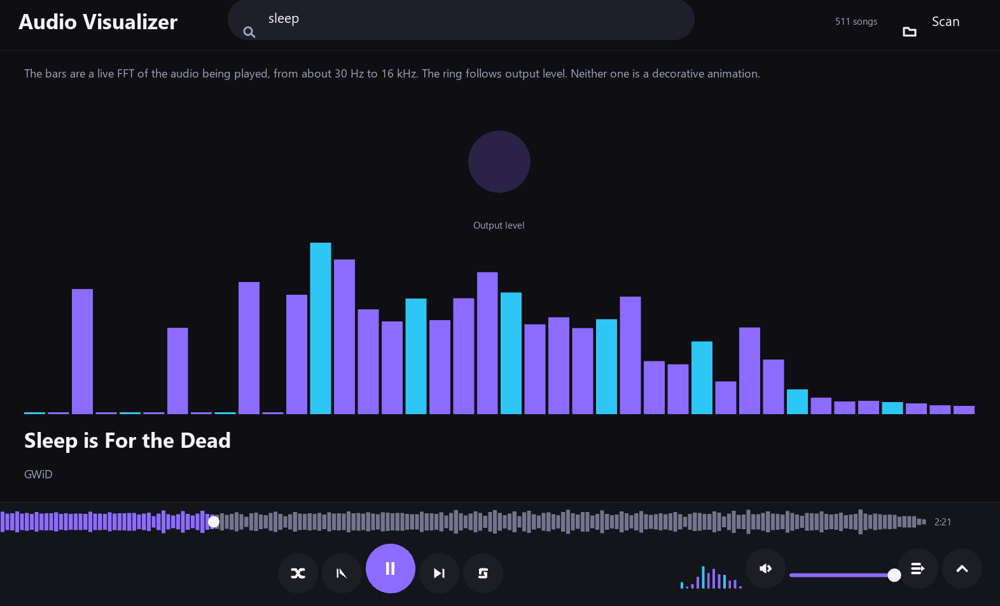
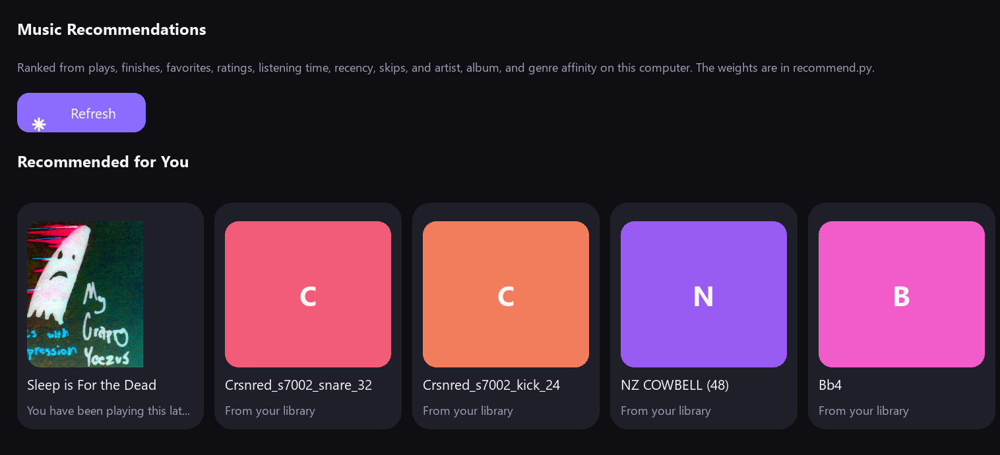
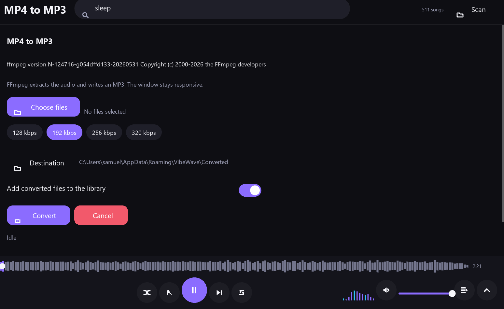
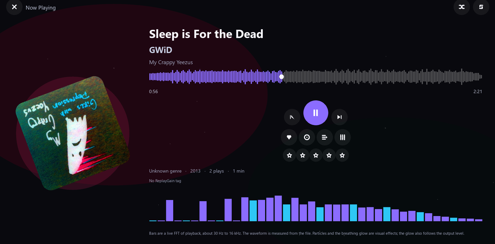
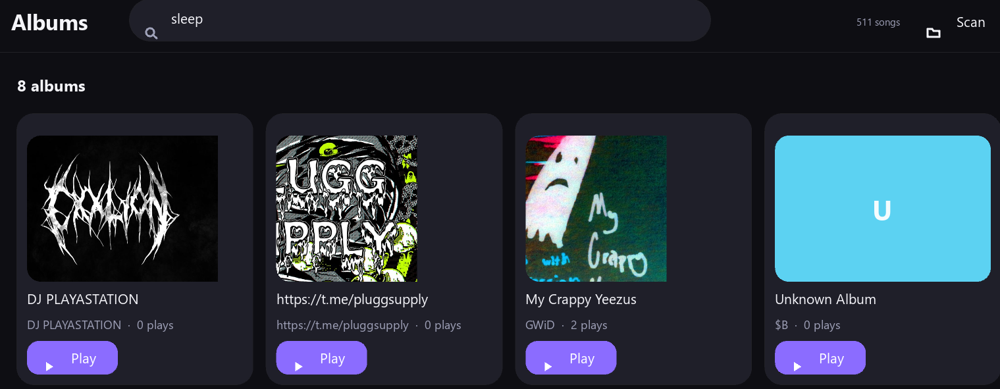
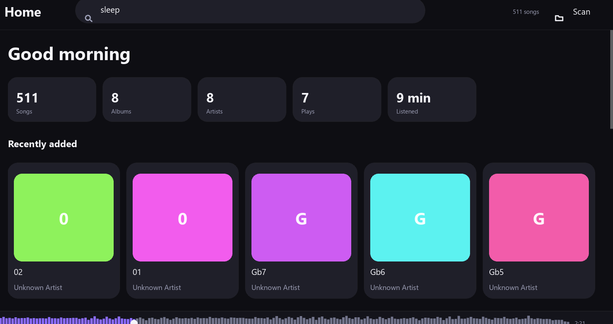
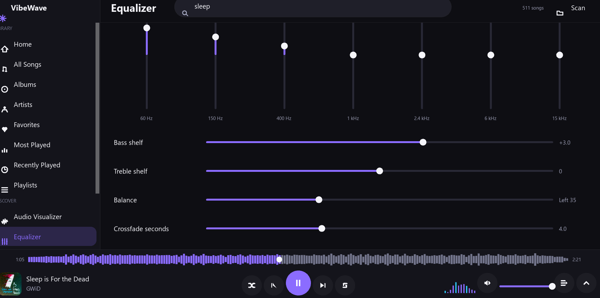

# VibeWave 🎵

<div align="center">
  
  <br>
  
  
  
</div>

<br>

**A powerful, privacy-first desktop music player built for your local library.**

VibeWave scans your chosen folders, delivers seamless playback, and builds a rich listening profile—including favorites, history, and smart recommendations—entirely offline. No network calls, no cloud tracking, just your music.

## 📸 Screenshots

<div align="center">
  
  <br>
  
  
  
  
  
  
</div>

## ✨ Features

- **Advanced Audio Pipeline:** Bypasses standard UI audio engines. Uses FFmpeg to decode to float PCM, routes through a SciPy-powered equalizer, and outputs via `sounddevice` for pristine audio quality.
- **Smart Local Recommendations:** Generates personalized suggestions based on your listening habits (plays, skips, finishes, favorites, and genre/artist affinity). Weights are locally computed without any external network calls or heavy machine learning models.
- **Bespoke Interface:** A fully custom Kivy 2.3.1 desktop UI featuring multiple views (Home, Albums, Artists, Playlists, Most Played, etc.), a persistent bottom player bar, and an expanded "Now Playing" overlay.
- **Built-in Tools:** Integrated Audio Visualizer, 10-band Equalizer, and an MP4-to-MP3 converter.
- **Persistent State:** Remembers your volume, theme, equalizer settings, last queue, and startup scan preferences between sessions.

## 🛠️ Requirements

- **Python:** 3.11 or newer (developed on 3.12).
- **System Dependencies:** `FFmpeg` and `ffprobe` must be installed and added to your system's `PATH` (required for decoding, waveform generation, and MP4-to-MP3 conversion).
- **Hardware:** A working audio output device.

> **Note on UI constraints:** This project intentionally avoids KivyMD. KivyMD 1.x introduces layout conflicts with this design, and the 2.x API lacks the stability required for this Kivy release line.

## 🚀 Getting Started

Clone the repository and run the application using a virtual environment:

```powershell
# Navigate to the project directory
cd VibeWave

# Install requirements
 pip install -r requirements.txt

# Launch VibeWave
python3 main.py
```

On your first launch, VibeWave will prompt you to select your music folders. The application operates in strict isolation—files outside of these chosen directories are never scanned.

## 📂 Library & Data Storage

All application data (the SQLite `library.db`, artwork cache, and application logs) is stored in your user directory:
`%APPDATA%\VibeWave`

_To override this and use a custom directory, set the `VIBEWAVE_DATA` environment variable._

**Supported Audio Formats:**
`MP3`, `WAV`, `FLAC`, `M4A`, `AAC`, `OGG`, and `OGA`.
_(Note: `.opus` files are not supported and are strictly ignored during imports. MP4 files are treated as inputs for the built-in converter, not as library tracks.)_

## ⌨️ Keyboard Shortcuts

VibeWave is built for power users. Navigate and control playback instantly:

| Key                     | Action                                     |
| ----------------------- | ------------------------------------------ |
| `Space`                 | Play / Pause                               |
| `Left` / `Right`        | Seek backward / forward 5 seconds          |
| `Up` / `Down`           | Increase / Decrease volume                 |
| `Ctrl + Left` / `Right` | Previous / Next track                      |
| `M`                     | Mute audio                                 |
| `F`                     | Toggle Favorite for current track          |
| `S`                     | Toggle Shuffle                             |
| `R`                     | Cycle Repeat (Off, All, One)               |
| `Q`                     | Open / Close Queue                         |
| `E`                     | Open / Close Equalizer                     |
| `N`                     | Toggle expanded "Now Playing" artwork view |
| `Ctrl + F`              | Focus Search bar                           |
| `Ctrl + .`              | Stop playback entirely                     |
| `Esc`                   | Close any open panel                       |

## 🧠 How Recommendations Work

VibeWave builds a profile of your tastes over time. A "play" is registered only after 30 seconds or half the track length (whichever comes first), and scrubbing through a track doesn't artificially inflate play counts.

The scoring algorithm lives in `vibewave/recommend.py` (under `WEIGHTS`). It mathematically balances your listening time, recency, ratings, and track affinity to serve fresh queues—all processed instantly on your local CPU.

**Developer Flags:**

- `VIBEWAVE_DEMO=1`: Seeds a lightweight, dummy library into the active data folder for UI testing.
- `VIBEWAVE_SMOKE=1`: Automatically walks through all screens and renders test PNGs to the `.smoke\` directory.

_Tip: Point the `VIBEWAVE_DATA` environment variable to a temporary folder before using these flags to ensure your actual music library remains untouched._
